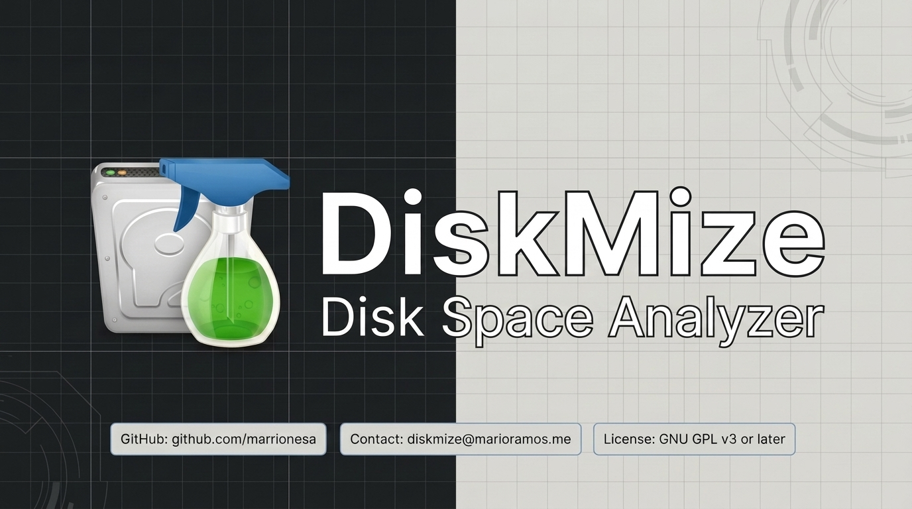
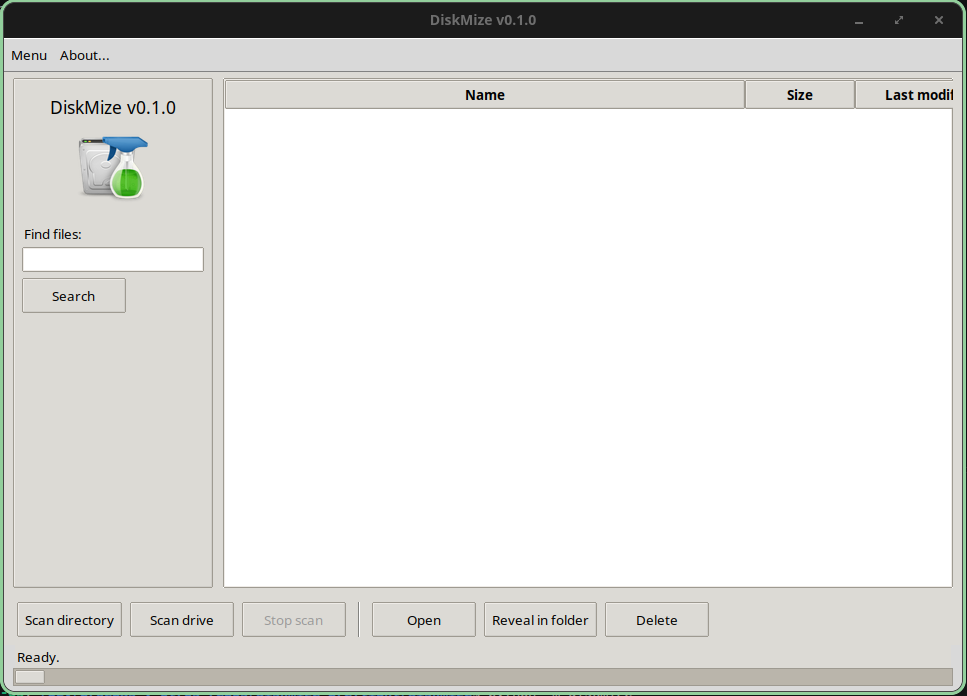
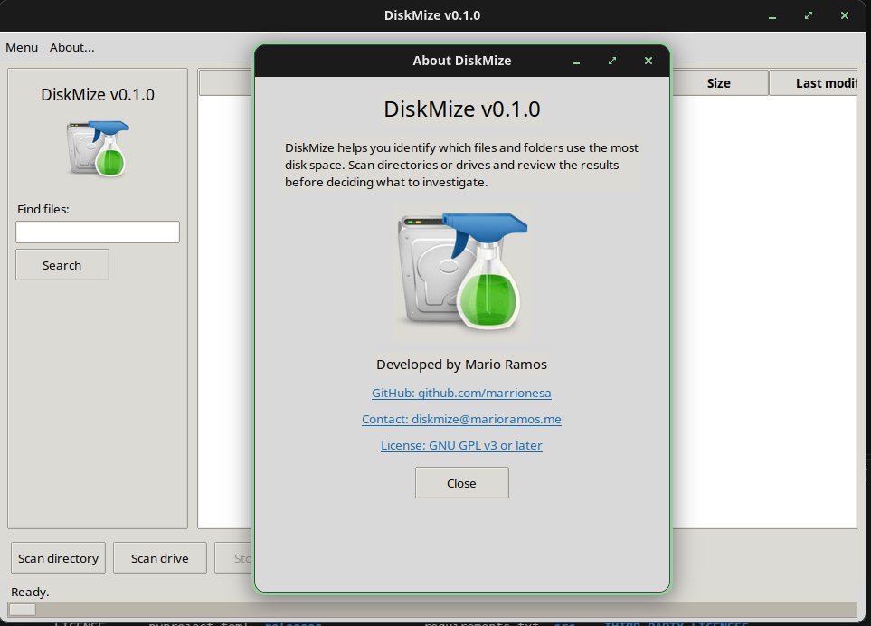
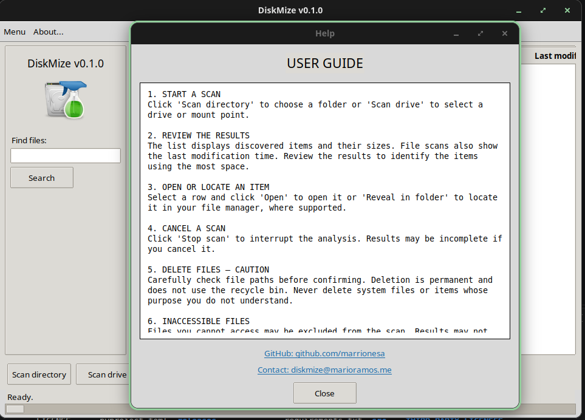
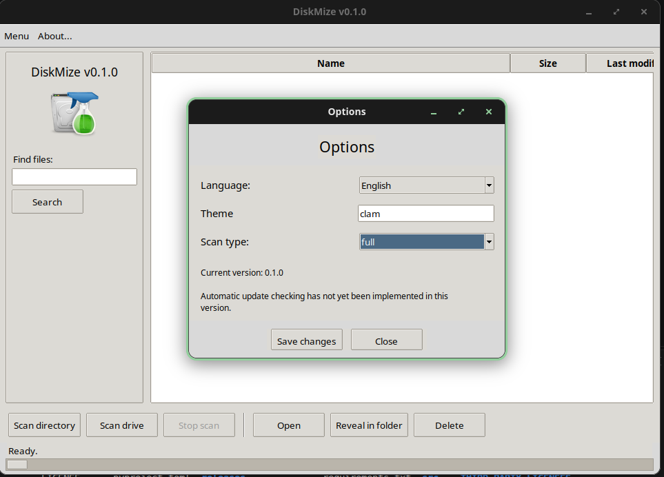

<div align="center">



# DiskMize

### A lightweight desktop tool to explore disk usage.

Inspect directories, find large files, and review storage usage through a straightforward graphical interface.

<p>
  <a href="https://www.python.org/"></a>
  <a href="LICENSE"></a>
  
  
</p>

<p>
  <a href="#features">Features</a> •
  <a href="#screenshots">Screenshots</a> •
  <a href="#installation">Installation</a> •
  <a href="#usage">Usage</a> •
  <a href="#development">Development</a> •
  <a href="#license">License</a>
</p>

</div>

---

## Overview

**DiskMize** is a desktop disk-space analyzer built with **Python** and **Tkinter**. It lets you scan a directory or drive, inspect discovered files and their sizes, and decide what needs further attention.

The interface is available in **English and Spanish** and includes file-location actions, scan controls, and configurable appearance options.

> [!WARNING]
> **Deleting files is permanent.** Review file paths and selections carefully before confirming a deletion. DiskMize does not use the recycle bin for its deletion operation.

## Features

- **Scan directories and drives** to inspect files and folders.
- **Review file sizes** and identify where storage is being used.
- **Search for files** using the application's search field.
- **Open or reveal items** using the available file-manager actions.
- **Cancel a running scan** when you need to interrupt analysis.
- **Choose the interface language**: English or Spanish.
- **Configure appearance and scan options** from the Options dialog.
- **Use a focused desktop UI** built with Python and Tkinter.

## Screenshots

### Main window

<p align="center">
  
</p>

### About DiskMize

<p align="center">
  
</p>

### Help and user guide

<p align="center">
  
</p>

### Options

<p align="center">
  
</p>

## Requirements

- **Python 3.12 or newer**
- **Tkinter** and the system Tcl/Tk components
- Runtime dependencies declared in `pyproject.toml`

Some Linux distributions package Tkinter separately from Python. If the application cannot import `tkinter`, install the appropriate Tk/Tcl package for your distribution.

## Installation

### Run from source

```bash
git clone https://github.com/marrionesa/diskmize.git
cd diskmize

python3 -m venv .venv
source .venv/bin/activate

python -m pip install --upgrade pip
python -m pip install .
```

Start the application:

```bash
python -m diskmize
```

### Development installation

To install the project in editable mode with its development dependencies:

```bash
python -m pip install -e ".[dev]"
```

## Usage

1. Launch DiskMize with `python -m diskmize`.
2. Select **Scan directory** to choose a folder, or **Scan drive** to select a drive or mount point.
3. Review the discovered items and their sizes.
4. Select an item to use the available **Open** or **Reveal in folder** action.
5. Before deleting anything, carefully verify the selected item and its path.

A cancelled scan or files that cannot be accessed may result in incomplete results.

## Development

Run these checks from the project root:

```bash
python -m pip check
python -m pytest -q
python -m ruff check src tests
python -m ruff format --check src tests
```

Some GUI integration tests may require an active graphical session or a virtual display such as Xvfb.

## Project structure

```text
diskmize/
├── assets/
│   └── images/             # README banner and screenshots
├── docs/                   # Project documentation
├── scripts/                # Build and preflight scripts
├── src/
│   └── diskmize/           # Application source code
├── tests/                  # Unit and integration tests
├── CONTRIBUTING.md
├── LICENSE
├── pyproject.toml
├── requirements.txt
└── README.md
```

## Documentation

- [Architecture](docs/ARCHITECTURE.md)
- [Dependencies and development checks](docs/DEPENDENCIES.md)
- [Contributing guide](CONTRIBUTING.md)
- [Third-party notices](THIRD_PARTY_NOTICES)

## Platform support

Linux is the platform tested in the current development environment. Windows and macOS compatibility has not been confirmed and should be tested before being advertised.

## License

DiskMize is free software released under the **GNU General Public License v3.0 or later** (`GPL-3.0-or-later`). See [`LICENSE`](LICENSE) for the full license text.

You may use, study, modify, and redistribute DiskMize under the terms of the GPL. If you distribute copies or modified versions, you must comply with the applicable license conditions, including requirements concerning notices and corresponding source code. The GPL permits commercial use.

## Contact

- **Developer:** Mario Ramos
- **Email:** [diskmize@marioramos.me](mailto:diskmize@marioramos.me)
- **GitHub:** [github.com/marrionesa](https://github.com/marrionesa)

---

<div align="center">

**DiskMize** · Disk Space Analyzer

Copyright © 2020–2026 Mario Ramos.

</div>
